# Unraid folder icons

Animerte SVG-mappeikoner for [FolderView2](https://github.com/VladoPortos/folder.view2) på Unraid.
Lim inn URL-en i ikonfeltet på mappen.

| Ikon | Mappe | URL |
|---|---|---|
|  | ai-tools | `https://raw.githubusercontent.com/menfre/unraid-folder-icons/main/svg/ai-tools.svg` |
|  | bots | `https://raw.githubusercontent.com/menfre/unraid-folder-icons/main/svg/bots.svg` |
|  | database | `https://raw.githubusercontent.com/menfre/unraid-folder-icons/main/svg/database.svg` |
|  | egne-apper | `https://raw.githubusercontent.com/menfre/unraid-folder-icons/main/svg/egne-apper.svg` |
|  | game-servers | `https://raw.githubusercontent.com/menfre/unraid-folder-icons/main/svg/game-servers.svg` |
|  | home-automation | `https://raw.githubusercontent.com/menfre/unraid-folder-icons/main/svg/home-automation.svg` |
|  | media-automation | `https://raw.githubusercontent.com/menfre/unraid-folder-icons/main/svg/media-automation.svg` |
|  | media-servers | `https://raw.githubusercontent.com/menfre/unraid-folder-icons/main/svg/media-servers.svg` |
|  | network | `https://raw.githubusercontent.com/menfre/unraid-folder-icons/main/svg/network.svg` |

## Endre ikonene

Alt genereres fra `generate.py`. Endre `ICONS` og kjør `python3 generate.py`. Åpne `preview.html` via en lokal server (`python3 -m http.server`) for å se dem.
